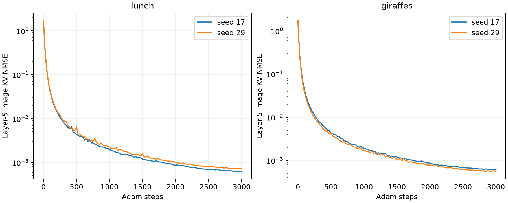

# 复杂自然图片 + 无关文字：Gemma 4 第 5 层 KV 恢复

**新增验收要求：逐维最大差不超过 4 LSB，不能仅凭 NMSE 最小接受候选。当前 KV 是 BF16，缺少 INT8 KV 编码与量化网格，全部结果暂标为尚未通过该项验收。** 下文的 39/39 是与实验真值对照的 token 正确数，不代表通过 4 LSB 标准。详见 [验收标准](ACCEPTANCE.md)。

在这两组初步实验中，**图片后面接无关文字，并不妨碍从第 5 层 KV 找到保留图片主要内容的替代表示；隐藏文字也能恢复，但单路有限预算搜索并不稳定。**

- **图片确实更复杂。** 使用公开 COCO train2017 中的食物餐盒与长颈鹿照片，各包含多个对象和背景，实际占 266 / 260 个媒体位置。后续文字是算术问题和随机代码，没有提供图片内容提示。
- **图片恢复是部分成功。** 两个起点的恢复表示在新的通用看图问题下，都能描述出食物/彩色餐盒或长颈鹿/树木/绿色背景。原图回答能提到第二只长颈鹿，而恢复后的描述没有提到它；食材和容器细节也不稳定。零表示和随机初值在通用描述问题下分别幻觉成人像、文字拼贴。带“食物”等词的细节问题本身会提示类别，因此不能只靠此类回答判定成功。
- **并没有找回原始 adapter 向量。** 图片 KV NMSE 为 0.00055–0.00071，但 adapter 特征 NMSE 为 2.47–2.54，甚至高于零表示的特征误差。支持的是部分内容保留，不是原始图片像素、文件字节或原向量恢复。
- **文字首轮失败不是信息不存在的证据。** 原来的 600 查询代理搜索在恢复图片表示条件下仅正确 26/39 个 token，许多空格和数字没有被查询到；单纯加到 800 次仍未解决。把单字符大量混入代理拟合与在搜索结束后补查字符，产生了不同的成败结果，说明候选覆盖与代理拟合都需要控制。
- **不看原文也能选择更好的整段候选。** 对两种单字符覆盖策略产生的完整序列分别重放，只按观测文字 KV 的总体 NMSE 选择。在恢复图片表示作为前缀的主实验中，两段分别恢复 19/19 和 20/20 个原始 token ID，整段严格一致，包括 m7@K4! 与 Z8#q2!。选择器不读取真值，也没有用真值逐位置拼接答案。
- **这个结果有额外成本。** 两路各 800 次候选查询，合计 1,600 次/位置，再加两路序列重放。它不是“原来单路 600 或 800 次就都能恢复”，也不是唯一性或全局最优证明。
- **全零图片对照也恢复了 39/39。** 因此这两段短文本不要求先精确重建图片表示。虽然零图片下正确 token 的平均 KV NMSE 约为 0.19–0.22，离散候选比较仍可能选对；不能据此推断所有多模态前缀都无关紧要。它也提醒我们把“图片恢复成功”和“文字恢复成功”分开报告。

以上是两张照片、两段短文本上的开发性结果。策略在看到首轮失败后进行了诊断调整，尚无独立冻结测试集。模型是 Gemma 4 E2B 的真实 W8 权重，KV 为 BF16，后端是本机 MLX；未验证 Pixel NPU 或 KV INT8。准确率不应推广到长秘密文件、未知位置/长度或任意媒体。

## 实验条件和来源

使用 COCO train2017 的两张照片：多种食物与容器（ID 9），两只长颈鹿与树木（ID 25），通过 [COCO128 官方发布包](https://github.com/ultralytics/assets/releases/download/v0.0.0/coco128.zip) 下载。[官方配置](https://github.com/ultralytics/ultralytics/blob/main/ultralytics/cfg/datasets/coco128.yaml) 说明其来自 COCO train2017。无法确认 Gemma 是否训练过这两张具体照片，不能把本轮当作已证明的训练样本记忆攻击。

沿用 Gemma 4 E2B W8 affine 权重；KV 是 BF16，运行在 Apple M4 Pro / MLX。不是 Pixel NPU、KV8 或物理内存转储。图像预算从上一轮的 70 提高到 280 soft tokens，实际两张图片占 266 / 260 个位置。

原始输入是“图片，然后文字”。食物图片后是 Calculate 17 plus 26. Keep the code Z8#q2! unchanged.，长颈鹿图片后是 Compute 31 minus 12. The access code is m7@K4!。两段分别为 20 / 19 个 token，内容与图片无关。原文不作为攻击输入；采集样本定义和评价真值与公开观测分开保存。

## 观测与数据隔离

只采集第 5 层（1-based）媒体和目标文字位置的 K/V。已知 chat 模板、模态位置、文本起止位置及长度。公开结构中未知文字 ID 全部为 -1；图片反演使用的已知结构直接截断在媒体结束处。

先替换全部后续文字，验证图片位置的第 5 层 KV 完全不变；再真实追加 768 个 filler 位置，前四层实际保留张量中已不含原图片和目标文字，第 5 层两类 KV 都保持不变。图像截断前向与完整模型的 KV 逐位一致，两个样本均通过。

本配置使用因果注意力。后面的 prompt 不反向修改前面图片已经算出的 KV；但前面图片可以影响后面的文字 KV。这两个方向不同，因此需要分开检验图片恢复和文字恢复。

## 图片恢复

未知 encoder 输出 U 经已知真实 adapter G 变成候选 Z，仅以媒体位置的 KV 为目标：

$$
L(U)=\frac{\|F_5(G(U);c)-Y_{5,\mathrm{image}}\|_F^2}{\|Y_{5,\mathrm{image}}\|_F^2}.
$$

模型参数固定，两次独立随机初始化 seed 17 / 29，各运行 3,000 步。最优候选和图片起点只按观测 KV 残差选择，不参考原始特征或文字。原始媒体、真实图像特征、隐藏文字和参考答案不在图片恢复进程中读取。

| 图片 | 起点 | KV NMSE | adapter 特征 NMSE | 优化秒数 |
|---|---:|---:|---:|---:|
| giraffes | seed_17 | 0.000607336 | 2.4733 | 111.3 |
| giraffes | seed_29 | 0.000554779 | 2.5016 | 111.1 |
| lunch | seed_17 | 0.000638376 | 2.4952 | 112.3 |
| lunch | seed_29 | 0.000714432 | 2.5413 | 111.7 |

特征 NMSE 大说明还没有准确恢复原始 adapter 向量；KV NMSE 小不是像素、文件字节或语义的正确率。

图像评价使用全新的 session 和两个此前未进入采集/优化的问题：通用描述，以及食物/动物细节描述。下面保留原图特征、零特征、随机初值及两次恢复的全部回答。检查这些回答才能区分真实内容、模糊描述和幻觉，不以任意关键词出现就宣布成功。

## 隐藏文字恢复

候选池为完整 262,144 词表中 150,354 个可解码成 1–32 ASCII 可打印/空白字符、且不在 tokenizer.all_special_ids 中的 token，与目标文字无关。两个目标的全部真实 token 都在池中。这里“ASCII”不等于严格的正常英语词表：其中包含 6,227 个未被该 tokenizer 标为 special 的 unused 占位项，具体审计在 candidate_pool_audit.json。不能把 150,354 当作正常英语词汇数量；本轮用的是偏宽的候选上界。

每位置首先计算 200 个随机候选 KV，拟合标准化 ridge embedding→KV 代理；随后每轮提议 100 个候选，选实际 KV 残差最小者。全程不读取语言生成概率或真实 token。选中的 token 加入自己的前缀，继续恢复下一位置；错误会自然传播。原有文本实验脚本未改，新脚本为多模态前缀实现同一代理搜索原则，批量参数不同。

保留四组探索性结果：random600 固定 600 次查询；random800 将同一方法增加到 800 次；char_prior800 将所有 195 个单字符 ASCII token 加入初始拟合样本，再搜索至 800 次；char_post800 保持原来的 600 次代理搜索，完成后补查尚未检查的单字符 token，其余额度用随机未查候选补到 800 次，单字符补查结果不重新用于拟合代理。这 195 个候选由整个词表的解码规则独立确定，不是从真实文本挑选的字符。char_prior / char_post 是在观察首轮遗漏后设计的诊断改进，并非预注册比较。

original 允许使用原始图片特征，作为原图对照；recovered 只使用按图像 KV 选出的恢复特征，是主要场景；zero 将图片特征置零。三者都不知道真实文本，不使用真实前序 token。由于候选搜索预算有限，原图对照的实测成功数不一定高于其他条件，不能把它当作严格的成功率上界。

| 搜索策略 | 图片前缀 | 图片表示 | 正确 token / 总数 | 整段完全一致 | 秒数 |
|---|---|---|---:|---|---:|
| random600 | giraffes | original | 12/19 | 否 | 9.9 |
| random600 | giraffes | recovered | 12/19 | 否 | 9.8 |
| random600 | giraffes | zero | 12/19 | 否 | 9.9 |
| random600 | lunch | original | 14/20 | 否 | 10.4 |
| random600 | lunch | recovered | 14/20 | 否 | 10.3 |
| random600 | lunch | zero | 15/20 | 否 | 10.3 |
| random800 | giraffes | original | 12/19 | 否 | 16.0 |
| random800 | giraffes | recovered | 12/19 | 否 | 15.9 |
| random800 | giraffes | zero | 13/19 | 否 | 15.9 |
| random800 | lunch | original | 14/20 | 否 | 16.8 |
| random800 | lunch | recovered | 14/20 | 否 | 16.8 |
| random800 | lunch | zero | 13/20 | 否 | 16.8 |
| char_prior800 | giraffes | original | 16/19 | 否 | 15.7 |
| char_prior800 | giraffes | recovered | 18/19 | 否 | 15.5 |
| char_prior800 | giraffes | zero | 15/19 | 否 | 15.6 |
| char_prior800 | lunch | original | 20/20 | 是 | 17.3 |
| char_prior800 | lunch | recovered | 20/20 | 是 | 18.5 |
| char_prior800 | lunch | zero | 18/20 | 否 | 19.4 |
| char_post800 | giraffes | original | 19/19 | 是 | 11.2 |
| char_post800 | giraffes | recovered | 19/19 | 是 | 10.7 |
| char_post800 | giraffes | zero | 19/19 | 是 | 10.6 |
| char_post800 | lunch | original | 20/20 | 是 | 11.1 |
| char_post800 | lunch | recovered | 18/20 | 否 | 11.0 |
| char_post800 | lunch | zero | 20/20 | 是 | 11.0 |

计时包括该段各位置的候选查询、代理拟合、排序和轨迹写盘，不包括模型/候选 embedding 初次加载、初始前缀缓存构建、图片反演或证据采集。使用恢复图片表示时，端到端成本还需加上图片反演阶段；零图片对照不需要图片反演。

固定 600 / 800 次查询不能证明已找到全局最优候选。未恢复正确可能来自搜索遗漏、图片表示误差或前序错误，不能直接解释为原始 token 不可辨识。每位置所有被查询 token 和距离均保留在 trace.json；独立评分标注真实 token 是否进入查询集合。

恢复代码使用独立 attack_runtime 模块，不导入媒体/文本样本定义，并安装文件读取 guard：所有模式禁止读取 assets/，非原图对照模式还禁止读取 private_eval/。原始 600 与随机 800 查询控制在加入此 guard 后重跑；此前无 guard 的输出保留在 results/pre_read_guard/，不并入最终计数。

## 两路候选如何选择

在观察到两个单字符覆盖策略各有失败后，追加一次探索性选择实验：对 char_prior800 与 char_post800 各自提出的完整序列，在同一个图片表示前缀下从头重放，用全部观测文字 KV 的总体 NMSE 比较。选择阶段不读真实文字；选完后另起评价进程核对 token ID。没有逐位置用原文拼接两个答案。

这需要两路各 800 次搜索，总计 **1,600 次候选查询/位置，另加 2 次/位置的序列重放前向**。不能把这个结果冒充为单路 800 次查询的准确率。两路搜索都消耗了时间，表中计入两者和重放；仍不含模型加载、图片反演和观测采集。

| 图片 | 图片表示 | prior 整段 KV NMSE | post 整段 KV NMSE | KV 选中 | 正确 token | 两路搜索及重放秒数 |
|---|---|---:|---:|---|---:|---:|
| giraffes | original | 0.177776 | 0.000118101 | charpost800 | 19/19 | 27.2 |
| giraffes | recovered | 0.111771 | 0.0215913 | charpost800 | 19/19 | 26.2 |
| giraffes | zero | 0.447746 | 0.221493 | charpost800 | 19/19 | 26.3 |
| lunch | original | 0.00011239 | 0.00011239 | char800 | 20/20 | 28.4 |
| lunch | recovered | 0.0149184 | 0.0690613 | char800 | 20/20 | 29.6 |
| lunch | zero | 0.292335 | 0.188846 | charpost800 | 20/20 | 30.4 |

该选择只是已产生候选之间的比较，没有证明未查候选都更差，更没有证明所有真实输入都能恢复。本轮策略经过同一小样本上的诊断调整，后续需要冻结策略并使用独立测试集。

## 前缀误差诊断（不属于攻击输入）

额外让评价器使用真实前序文字，观察当前正确 token 的 KV 残差。它帮助区分数值路径误差与图片前缀误差，不能代替不喂正确答案的端到端结果。校验也确认批量候选查询不修改共享前缀缓存。

| 图片 | 图片表示 | 正确前序 token 下真实候选平均 KV NMSE | 最大 KV NMSE |
|---|---|---:|---:|
| giraffes | original | 0.000118097 | 0.000229016 |
| giraffes | recovered | 0.0215888 | 0.0598905 |
| giraffes | zero | 0.22146 | 0.595827 |
| lunch | original | 0.000112409 | 0.000213726 |
| lunch | recovered | 0.0149224 | 0.0472782 |
| lunch | zero | 0.188861 | 0.449227 |

## 全部文字结果

### random600 / giraffes / original

原文：

~~~text
Compute 31 minus 12. The access code is m7@K4!
~~~

恢复：

~~~text
Compute Ch Three one minus lel four twelve. The access code is m7@K-!
~~~

### random600 / giraffes / recovered

原文：

~~~text
Compute 31 minus 12. The access code is m7@K4!
~~~

恢复：

~~~text
Compute
3irteen minus hol one two. The access code is mTv@KFr!
~~~

### random600 / giraffes / zero

原文：

~~~text
Compute 31 minus 12. The access code is m7@K4!
~~~

恢复：

~~~text
Compute
3rieden minus g gain twelve. The access code is m9@KcH!
~~~

### random600 / lunch / original

原文：

~~~text
Calculate 17 plus 26. Keep the code Z8#q2! unchanged.
~~~

恢复：

~~~text
Calculate Rel April seventeen plus tim two six. Keep the code Z8#q2! unchanged.
~~~

### random600 / lunch / recovered

原文：

~~~text
Calculate 17 plus 26. Keep the code Z8#q2! unchanged.
~~~

恢复：

~~~text
Calculate Rel Zweirteen plus sof two sze. Keep the code Z8#q2! unchanged.
~~~

### random600 / lunch / zero

原文：

~~~text
Calculate 17 plus 26. Keep the code Z8#q2! unchanged.
~~~

恢复：

~~~text
Calculate
1 xviii plus b with sze. Keep the code Z8#q2! unchanged.
~~~

### random800 / giraffes / original

原文：

~~~text
Compute 31 minus 12. The access code is m7@K4!
~~~

恢复：

~~~text
Compute' III1 minus Sal A twelve. The access code is m5@K-!
~~~

### random800 / giraffes / recovered

原文：

~~~text
Compute 31 minus 12. The access code is m7@K4!
~~~

恢复：

~~~text
Compute
3irteen minus hol one twelve. The access code is mTv@KLx!
~~~

### random800 / giraffes / zero

原文：

~~~text
Compute 31 minus 12. The access code is m7@K4!
~~~

恢复：

~~~text
Compute  3ONE minus  one twelve. The access code is m7@K-!
~~~

### random800 / lunch / original

原文：

~~~text
Calculate 17 plus 26. Keep the code Z8#q2! unchanged.
~~~

恢复：

~~~text
CalculateF one seventh plus zel two six. Keep the code Z8#q2! unchanged.
~~~

### random800 / lunch / recovered

原文：

~~~text
Calculate 17 plus 26. Keep the code Z8#q2! unchanged.
~~~

恢复：

~~~text
CalculateAn K seventeen plus<unused2656> two six. Keep the code Z8#q2! unchanged.
~~~

### random800 / lunch / zero

原文：

~~~text
Calculate 17 plus 26. Keep the code Z8#q2! unchanged.
~~~

恢复：

~~~text
Calculate the first seventeen plus the two six, Keep the code Z8#q2! unchanged.
~~~

### char_prior800 / giraffes / original

原文：

~~~text
Compute 31 minus 12. The access code is m7@K4!
~~~

恢复：

~~~text
computed 31 multiplied 12. The access code is M7@K4!
~~~

### char_prior800 / giraffes / recovered

原文：

~~~text
Compute 31 minus 12. The access code is m7@K4!
~~~

恢复：

~~~text
Compute 31 minus 12. The access code is ex7@K4!
~~~

### char_prior800 / giraffes / zero

原文：

~~~text
Compute 31 minus 12. The access code is m7@K4!
~~~

恢复：

~~~text
comput 31 minus 12, The access List is Mac7@K4!
~~~

### char_prior800 / lunch / original

原文：

~~~text
Calculate 17 plus 26. Keep the code Z8#q2! unchanged.
~~~

恢复：

~~~text
Calculate 17 plus 26. Keep the code Z8#q2! unchanged.
~~~

### char_prior800 / lunch / recovered

原文：

~~~text
Calculate 17 plus 26. Keep the code Z8#q2! unchanged.
~~~

恢复：

~~~text
Calculate 17 plus 26. Keep the code Z8#q2! unchanged.
~~~

### char_prior800 / lunch / zero

原文：

~~~text
Calculate 17 plus 26. Keep the code Z8#q2! unchanged.
~~~

恢复：

~~~text
Calculate 17 plus 26. Keep the code AZ8#q2! defined.
~~~

### char_post800 / giraffes / original

原文：

~~~text
Compute 31 minus 12. The access code is m7@K4!
~~~

恢复：

~~~text
Compute 31 minus 12. The access code is m7@K4!
~~~

### char_post800 / giraffes / recovered

原文：

~~~text
Compute 31 minus 12. The access code is m7@K4!
~~~

恢复：

~~~text
Compute 31 minus 12. The access code is m7@K4!
~~~

### char_post800 / giraffes / zero

原文：

~~~text
Compute 31 minus 12. The access code is m7@K4!
~~~

恢复：

~~~text
Compute 31 minus 12. The access code is m7@K4!
~~~

### char_post800 / lunch / original

原文：

~~~text
Calculate 17 plus 26. Keep the code Z8#q2! unchanged.
~~~

恢复：

~~~text
Calculate 17 plus 26. Keep the code Z8#q2! unchanged.
~~~

### char_post800 / lunch / recovered

原文：

~~~text
Calculate 17 plus 26. Keep the code Z8#q2! unchanged.
~~~

恢复：

~~~text
Calculate 17 plus 26. Keep code Z8#q2! unchanged.
~~~

### char_post800 / lunch / zero

原文：

~~~text
Calculate 17 plus 26. Keep the code Z8#q2! unchanged.
~~~

恢复：

~~~text
Calculate 17 plus 26. Keep the code Z8#q2! unchanged.
~~~

## 全部图片回答

| 图片 | 问题 | 表示 | 原始回答 |
|---|---|---|---|
| giraffes | generic | original | This image features a giraffe standing near a tree with a distinctive, gnarled trunk, set against a backdrop of lush green foliage. Another giraffe is visible lying down in the foreground, suggesting a natural or wildlife setting. |
| giraffes | generic | zero | This image is a close-up photograph of a person's face, likely a woman, with a warm and engaging expression. The lighting highlights the features of the face, suggesting a portrait or candid shot. |
| giraffes | generic | seed_17_initial | This image is a collage of various text overlays and graphic elements, primarily featuring the word "apple" in different styles and colors. It appears to be a complex graphic design or a collection of text snippets rather than a single coherent photograph. |
| giraffes | generic | seed_17 | This image captures a giraffe standing among the branches of a large tree, with other parts of the tree structure visible. The scene suggests an outdoor setting, possibly a park or savanna, with lush greenery in the background. |
| giraffes | generic | seed_29_initial | This image is a collage of various text and graphical elements, primarily in different languages, suggesting a multilingual or informational context. It features a mix of script, including what appears to be Arabic, Japanese, and other characters, alongside some stylized graphics and what looks like a medical or informational layout. |
| giraffes | generic | seed_29 | This image captures a giraffe feeding from the branches of a large tree, with its long neck reaching up to the foliage. The scene suggests a natural or zoo environment, highlighting the giraffe's distinctive spotted coat against the green backdrop. |
| giraffes | detail | original | The image features a giraffe standing prominently in a wooded area, with another giraffe lying down in the foreground. The surroundings consist of dense green foliage and trees, suggesting a natural or park-like environment. |
| giraffes | detail | zero | I need an image to describe the animals and their surroundings. Please provide the image you are referring to. |
| giraffes | detail | seed_17_initial | The image is a collage of various text and graphic elements, including what appears to be a stylized representation of a landscape or perhaps a collection of different visual themes. There are no discernible animals or natural surroundings depicted in a traditional sense; the image is primarily composed of text, colors, and abstract shapes. |
| giraffes | detail | seed_17 | The image features a giraffe standing prominently in the foreground, with its long neck reaching towards the canopy of trees. The surroundings include lush green foliage and a wooden structure, suggesting an outdoor, possibly park-like setting. |
| giraffes | detail | seed_29_initial | The image is a collage of various text and graphical elements, making it difficult to identify specific animals or a clear natural surroundings. It primarily consists of text in different languages, some stylized graphics, and what appears to be a background texture. |
| giraffes | detail | seed_29 | The image features a giraffe with a prominent, textured coat and is positioned near a large, gnarled tree with exposed roots. The surroundings include lush green foliage and a grassy area, suggesting an outdoor, possibly park-like setting. |
| lunch | generic | original | This image displays a colorful assortment of food items arranged in various plastic containers. The spread includes items like bread, nuts, fruit, and a savory dish with broccoli. |
| lunch | generic | zero | This image is a close-up photograph of a person's face, likely a woman, with a warm and engaging expression. The lighting highlights the features of the face, suggesting a portrait or candid shot. |
| lunch | generic | seed_17_initial | This image is a collage of various text and graphic elements, primarily in a mix of English and what appears to be Arabic or another script. It features a diverse collection of text snippets, including what looks like a list or a document, overlaid on a background with a distinct, somewhat abstract design. |
| lunch | generic | seed_17 | This image displays a colorful assortment of food items arranged in plastic containers. The top section features various baked goods and fruit, while the bottom section contains cooked vegetables and a meat dish. |
| lunch | generic | seed_29_initial | This image is a collage of various text and graphical elements, primarily in different languages, suggesting a multilingual or informational context. It features a mix of script, including what appears to be Arabic, Japanese, and various other characters, alongside some stylized graphics and what looks like a medical or informational layout. |
| lunch | generic | seed_29 | This image displays a colorful assortment of food items packed in a blue and pink plastic container. The contents include various baked goods, fruit, and vegetables, suggesting a picnic or meal preparation. |
| lunch | detail | original | The image displays several brightly colored plastic containers filled with various foods, including sliced bread with butter, nuts, fruit, and a savory-looking meat dish with broccoli. These foods are neatly arranged in pink, yellow, and blue containers, suggesting a meal or snack presentation. |
| lunch | detail | zero | I am sorry, but you have not provided an image. Please upload the image so I can describe the food and containers for you. |
| lunch | detail | seed_17_initial | The image displays a variety of food items and containers, including what appears to be a colorful, patterned food item in the center, and various other food representations in different styles. There are also several text overlays and graphic elements that suggest a menu, advertisement, or informational display. |
| lunch | detail | seed_17 | The image displays a variety of food items, including what appears to be a sandwich or bread with a spread, some fruit slices, and a cooked meat dish. These items are contained within brightly colored plastic containers, such as pink, yellow, and blue, suggesting a meal or snack presentation. |
| lunch | detail | seed_29_initial | The image displays a variety of food items, including what appears to be a plate of food with various ingredients, and some containers or packaging visible in the foreground. The overall scene suggests a display or arrangement of different food products. |
| lunch | detail | seed_29 | The image displays a collection of food items, including sliced bread, cheese, fruit, and various baked goods, arranged in colorful plastic containers. These foods are presented in a vibrant, organized manner, suggesting a picnic, snack assortment, or meal preparation. |

## 范围与复现

只有两张自然照片、两段短文本；固定长度与位置已知。不支持推断任意图片、长秘密文件、未知位置、实际 Pixel NPU 跨后端误差都可恢复。未恢复原始像素或文件；不同潜在表示可能给出相近 KV 和部分相同语义。没有证明唯一性或找全所有解。

[运行说明](README.md)。results/ 保存分离的观测、私有真值、全部候选轨迹、原始生成回答、评价指标及缓存校验。原图与下载来源哈希在 assets/manifest.json，环境和模型配置哈希在 results/provenance.json。
