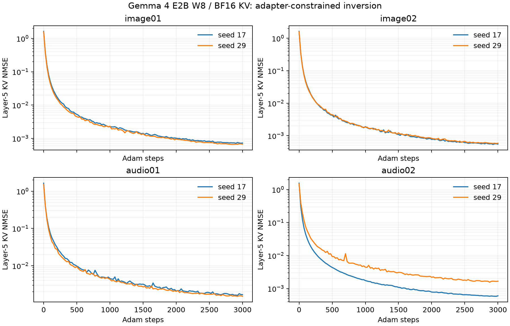

# Gemma 4 第 5 层图片与音频初步反演实验

本报告记录 RQ3 / RQ4 的小型可复现实验。结果来自真实 Gemma 4 E2B encoder、adapter 和解码器的运行时 KV，不是随机网络或手工构造的目标向量。

## 主要发现

第 5 层 KV 支持找出能保留本轮部分媒体内容的替代表示，但没有准确恢复原始 adapter 向量。两个独立初始化得到的表示明显不同，均能把 KV 误差降得很低。

- 两张图 × 两个起点的 4 次恢复：颜色和数字均正确；严格形状描述只有蓝色圆形的两次完全正确。红色正方形被描述为 Square/Rectangle，其中一次还出现不存在的圆角，不能记为严格成功。
- 两段语音 × 两个起点的 4 次恢复：规范化后的转录都与原模型一致，42 / 57 均读出。但原模型和恢复模型都把第一段的 secret 识别为 sacred，故并非逐字恢复源语音。
- 8 次恢复的 KV NMSE 为约 0.00055–0.00158；图片特征 NMSE 仍为 1.80–2.03，音频为 0.485–0.735。低 KV 残差没有带来低特征误差。
- 最终每次优化约 32–44 秒，两起点合计每个媒体约 65–87 秒；8 次合计约 323 秒，仅计优化阶段。

所有这些计数来自 2 张图和 2 段语音，重复起点不能增加独立媒体样本数。零特征和随机初始化对照均没有读出正确的对应数字。本轮结论是存在内容恢复信号，不是已恢复原始图片、音频或唯一潜在表示。

## 实验条件

- Apple M4 Pro，MLX；模型权重 W8 affine，实际 KV 为 BF16。**不是 NPU 实验，也不是 KV8 实验或物理内存取证。**
- 固定模型 revision 03dcf209f3f549b4075e7191e77cf69b3d48e1b2；完整环境版本见 results_long/provenance.json 与 requirements.lock.txt。
- 两张图片：红色正方形 + 42、蓝色圆形 + 57，真实视觉 encoder 各产生 64 个媒体位置。
- 两段合成语音：The secret number is forty two. / The blue door has number fifty seven.，真实音频 encoder 产生 45 / 54 个媒体位置。
- 图像 max_soft_tokens=70；实际图像与音频 adapter 输出宽度均为 1,536。
- 只观察第 5 层（代码索引 4）媒体位置的 K 和 V，每个位置共 1,024 个数值；没有提供第一层 KV、原始媒体、真实 adapter 特征或转录。
- 已知 prompt、媒体位置和位置数；加载配置 use_bidirectional_attention=null，遵循此 MLX 路径的因果 mask。不能假定所有 Gemma 部署使用相同媒体 mask。

## 窗口淘汰与前向核验

先使用完整 35 层模型处理媒体，再真实追加 768 个已知 filler 位置。追加过程中使用运行时的 rotating cache。在 0、256、512、768 四个检查点，第 5 层媒体 KV 相对初始值的 NMSE 都为 0。

最终前四层的实际保留张量已不含媒体位置。每批追加 64 个位置时，局部缓存会暂存最多 575 个位置，因此不能仅根据“窗口 512”推断物理保留条目数；最终淘汰断言检查的是实际张量范围，而不仅是 attention mask。详细记录见各样本 private_eval/eviction.json。

用于优化的截断前向图与完整模型产生的第 5 层 KV 在所有四个样本上逐位一致（NMSE=0）。恢复只需运行前四个完整 block 和第 5 层 KV 投影；第 5 层自己的 attention/FFN 在这个观测点之后。

## 方法与数据隔离

将未知表示写成 Z=G(U)，G 是已知的真实 adapter。图片 U 每位置 768 维，音频 U 为 1,536 维。所有模型参数固定，只更新 U：

$$
L(U)=\frac{\|F_5(G(U);c)-Y_5\|_F^2}{\|Y_5\|_F^2}.
$$

这里 c 为已知非媒体输入结构，Y5 为采得的 KV。没有使用内容标签、正确转录、真实特征或答案监督。优化进程只加载 observed/ 和模型；private_eval/ 仅在独立的 evaluate 阶段读取。

每例使用 seed 17、29 两个独立标准高斯初始化，Adam 3,000 次更新（含初始检查共 3,001 次目标函数及梯度计算），初始学习率 0.08、固定余弦衰减。每步将 U 的逐位置 RMS 归一化，利用 adapter 本身的 RMSNorm 去除径向漂移；有限精度和 epsilon 下并非严格的缩放不变性。按最小 KV 残差保留候选，既不提前因“恢复正确”停止，也不按真实特征挑 seed。低精度 cast 的自动微分提供近似梯度；保存后再次通过实际前向图测量 KV 残差，所以该值可与优化内部的最小记录略有尾差。

## 数值结果

NMSE 是误差平方和除以真实向量平方和，**不是正确率或“错误 token 百分比”**。例如特征 NMSE 大于 1，表示平方误差比把真实特征全部置零还大；不能据此宣称恢复了原始特征。cosine 仅作辅助描述。

| 样本 | seed | KV NMSE | adapter 特征 NMSE | 特征 cosine | 优化秒数 |
|---|---:|---:|---:|---:|---:|
| audio01 | 17 | 0.0015513 | 0.6410 | 0.6143 | 32.44 |
| audio01 | 29 | 0.00151101 | 0.6288 | 0.6265 | 32.28 |
| audio02 | 17 | 0.000587725 | 0.4850 | 0.7197 | 42.02 |
| audio02 | 29 | 0.00157737 | 0.7345 | 0.5500 | 41.96 |
| image01 | 17 | 0.000708559 | 1.9752 | 0.4364 | 43.68 |
| image01 | 29 | 0.000655117 | 2.0336 | 0.4244 | 43.68 |
| image02 | 17 | 0.000546096 | 1.8036 | 0.4698 | 43.72 |
| image02 | 29 | 0.000564045 | 1.8475 | 0.4563 | 43.66 |

优化耗时仅包括该次输入反演与保存候选，不包括模型加载、原始媒体编码、缓存采集或后续答案生成；两个 seed 的成本应相加，不能只报选中 seed 的成本。

## 内容复测与对照

把恢复的 Z 插入一个全新的 Gemma session，采用原任务的已知问题，生成图片属性/数字或音频转录。这里是**固定问题的功能复测**，没有验证任意未见问题。原始 Z、全零 Z、随机初始化 Z 均保留，避免把模型猜测算作反演成功。

以下列出全部原始回答；图片标签出现统计仅是字符串指标，存在矛盾或额外幻觉时仍需核对原文。

| 样本 | 表示 | 新 session 的实际回答 |
|---|---|---|
| audio01 | original | The sacred number is 42 |
| audio01 | zero | （空输出） |
| audio01 | seed_17_initial | advese |
| audio01 | seed_17 | The sacred number is 42 |
| audio01 | seed_29_initial | ее поте |
| audio01 | seed_29 | The sacred number is 42 |
| audio02 | original | The blue door has number 57. |
| audio02 | zero | （空输出） |
| audio02 | seed_17_initial | adves. |
| audio02 | seed_17 | The blue door has number 57 |
| audio02 | seed_29_initial | एक पे के |
| audio02 | seed_29 | The blue door has number 57. |
| image01 | original | **Shape:** Square **Color:** Red **Number:** 42 |
| image01 | zero | Please provide the image you are referring to. I need an image to tell you the shape, color, and number. |
| image01 | seed_17_initial | Based on the image provided, here is the description:  * **Shape:** A shield or crest shape. * **Color:** Primarily dark blue/black with gold/yellow accents. * **Number:** There is no distinct, clear number visible in the image. |
| image01 | seed_17 | **Shape:** Square/Rectangle (with rounded corners implied by the context of a flag/design) **Color:** Red **Number:** 42 |
| image01 | seed_29_initial | Please provide the image you are referring to. I need an image to tell you the shape, color, and number. |
| image01 | seed_29 | **Shape:** Square/Rectangle (the main object is a red rectangle) **Color:** Red **Number:** 42 |
| image02 | original | **Shape:** Circle **Color:** Blue **Number:** 57 |
| image02 | zero | Please provide the image you are referring to. I need an image to tell you the shape, color, and number. |
| image02 | seed_17_initial | Based on the image provided, here is the description:  * **Shape:** A shield or crest shape. * **Color:** Primarily dark blue/black with gold/yellow accents. * **Number:** There is no distinct, clear number visible in the image. |
| image02 | seed_17 | **Shape:** Circle **Color:** Blue **Number:** 57 |
| image02 | seed_29_initial | Please provide the image you are referring to. I need an image to tell you the shape, color, and number. |
| image02 | seed_29 | **Shape:** Circle **Color:** Blue **Number:** 57 |

音频评分另见 results_long/scored.json：统一大小写、标点，并把 forty two / fifty seven 与 42 / 57 对齐。其余词语不替换；secret 与 sacred 仍算错误。原模型自身的误听与恢复引入的误听分开看，不能用复现原回答证明源音频逐字正确。

## 不同起点是否得到同一表示

| 样本 | 两次恢复表示的差平方 / 真实表示能量 |
|---|---:|
| audio01 | 0.5526 |
| audio02 | 0.5673 |
| image01 | 2.9601 |
| image02 | 2.6519 |

这些非零差异结合各自的 KV 残差，只能说明有限优化找到了不同的近似候选。它们不是“找到所有解”的证书，也没有证明全局最小值或精确碰撞。

## 初轮记录与范围

results/ 保存先完成的 300 步探索轮，assets_pilot300/ 保存对应素材。初轮绘图边框宽高不等，实际是略宽的矩形/椭圆；最终 3,000 步轮在 assets/ 修正为正方形/圆形并重新采集全部目标。因此两个图片轮次不能当作仅改变迭代次数的严格配对实验。音频素材未变。初轮失败与误读未删，初轮不并入最终样本数。

总共只有两张简单图片和两段干净合成语音；两个起点不算两个独立媒体样本。本轮是开发性实验，没有独立冻结的测试集。尚未覆盖真实照片、复杂 OCR、噪声音频、未知前缀、缺失坐标、跨执行后端误差、完整 280-token 图像或 Pixel NPU。也未恢复原图像素、音频波形或原文件字节。后续应使用独立媒体集、未见问题和实际 NPU 观测继续验证。

## 文件

- experiment.py：采集 / 反演 / 评估三个隔离阶段。
- runtime.py：已知模型前向、adapter 插入与新 session 内容复测。
- summarize.py：独立评分、断言、图表与报告生成。
- results_long/observed/：仅恢复过程允许读取的 KV 和已知结构。
- results_long/recovered/：两起点的恢复表示、初始化、轨迹和耗时。
- results_long/private_eval/：真实表示、媒体标签和窗口日志，仅用于评分。
- results_long/evaluation.json、scored.json：原始回答、误差指标和检查结果。
