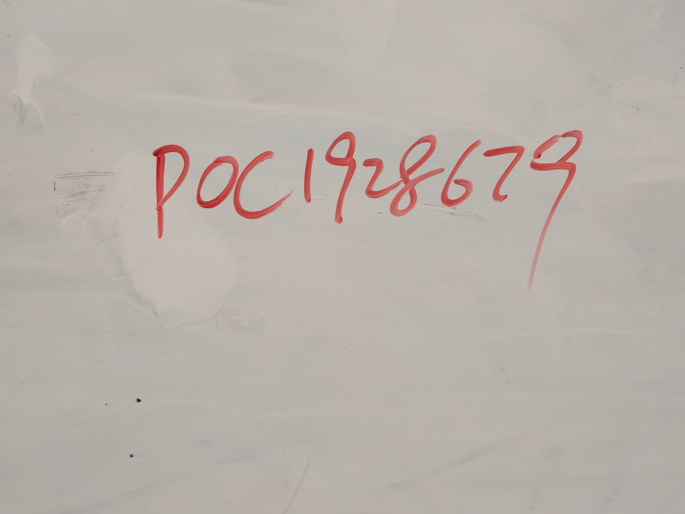
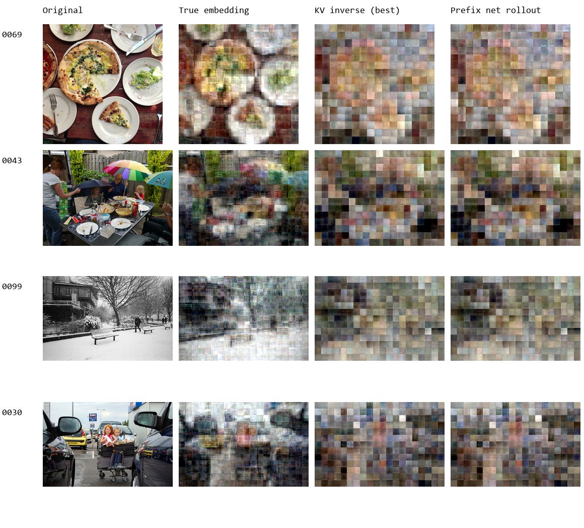

# Gemma 4 Image Prefix Dataset

真实 Pixel 10 / Gemma 4 E2B 图片 embedding 与 INT8 KV 的先导数据集，用于探索：

```text
(prefix embeddings, current K/V, position) -> current image embedding candidate
```

**这是固定 causal prefill 协议下的真实 NPU 数据，不是模拟量化数据。**
视觉编码器和 adapter 在手机 CPU，语言解码器在 NPU。原始数据保存真实前缀 embedding。
现已完成小规模逆向模型训练、预测前缀连续恢复与图片重建对照，见下面的实验更新。
尚未达到完整图片恢复，也未验证预测 embedding 在 NPU 回放后的 K/V 误差。

## 2026-10-23 固定前缀 1000 张与重点测试图片

固定 **991-token 前缀**（上一轮对话 511 tokens）的真实手机 NPU 数据，包含 **1000 张 HierText 训练来源图片**。与此前变化前缀的数据集不同。现已完成一轮 RASR 思路的小规模联合图像重建验证。

[下载数据与重点测试观测](https://github.com/slittlefingers/gemma4-image-prefix-dataset/releases/tag/v2026.10.23-fixed-prefix-1000) · [数据说明与解压步骤](datasets/20261023_fixed991_1000/README.md)

[显式 K/V 量化参数](datasets/20261023_fixed991_1000/quantization_named.json) · [反量化读取示例](examples/dequantize_fixed_kv.py)。训练读取时建议 INT8 → FP32 反量化，再用训练集统计量标准化。

重点测试对象是单独保留的白板手写照片，用户已授权公开。它及其真实特征不得用于训练或选择模型；[测试对象说明](important_test/whiteboard/README.md)。



### 联合图像重建验证

按来源图片 ID 划分 800 / 100 / 100 张训练、验证、测试图，使用整张图的第 5 层 INT8 K/V，训练约 465 万参数的 Transformer 与图像解码器，只用像素 MSE 联合监督。独立白板不用于训练或选择模型。

在同一批 100 张测试图上，分段线性链路、平滑后的分段链路、联合模型的 PSNR 分别为 **11.72 / 12.12 / 13.28 dB**。**粗略像素重建有所改善，但白板文字未恢复。** 白板 SSIM 较高不能说明文字成功恢复，纯色对照的 SSIM 甚至更高。

这是 *Inverting the Hidden* 初始视觉重建阶段的缩小适配，输入为 K/V 而非完整 hidden states；未执行原模型梯度精修，也未测量重建图重新跑 NPU 的 K/V 误差。

[完整实验报告与复现步骤](experiments/20261023_fixed991_rasr/README.md) · [10 张测试图片还原样例](experiments/20261023_fixed991_rasr/test_gallery/README.md) · [白板重建对照](experiments/20261023_fixed991_rasr/results/whiteboard_smoothing_control.png) · [逐图指标与平滑诊断](experiments/20261023_fixed991_rasr/results/diagnostics.json)

## 2026-10-23 数据扩充：10 倍位置样本

已完成 **80 条真实 NPU 序列、640 张独立图片、158,160 个目标位置**。训练 / 验证 / 测试分别为 60 / 10 / 10 条序列、480 / 80 / 80 张图片。前缀范围仍为 10–2000，图片来自 COCO val2017，prompt 模板与先导版一致。

图片级划分和源文件哈希检查通过；保持采集分块的新 NPU 会话重放一条序列，1982 个图片位置的 K/V 全部逐位一致。**扩充版尚未重新训练，下面的模型结果仍属于 2026-10-22 小数据实验。**

- [扩充版数据说明、完整下载与解压步骤](datasets/20261023_expanded_10x/README.md)
- [下载两个数据包及 SHA256SUMS](https://github.com/slittlefingers/gemma4-image-prefix-dataset/releases/tag/v2026.10.23-expanded-10x)
- [采集协议](datasets/20261023_expanded_10x/protocol.json) · [校验结果](datasets/20261023_expanded_10x/validation.json)

## 2026-10-22 实验更新

使用原有图片级划分（40 张训练、8 张验证、8 张测试），训练
`前缀 embedding + 当前第 5 层 INT8 K/V + 位置 → 当前图片 embedding`。
输入 K/V 来自真实 INT8 采集；adapter 后的 embedding 标签为 **FP32**，逆向模型在 GPU 上使用 FP32 训练。

| 方法 | 测试 embedding 每维 RMSE | 相对 RMSE |
|---|---:|---:|
| 当前 K/V 线性回归 | 0.3066 | 56.89% |
| 训练到第 2000 步的前缀网络，真实前缀 | 0.3081 | 57.16% |
| 同一网络，逐位置使用预测前缀 | 0.3083 | 57.21% |

表中网络结果为三个随机种子的平均。三次验证集最优检查点均为第 0 步线性初始化：
**当前前缀网络训练没有超过线性模型。** 上述数值是 embedding 误差，不是 K/V 的 LSB 误差，也不是图片恢复率。

另用 40 张训练图训练图片解码器，7 张完整测试图上，真实 embedding 重建平均 PSNR 为
19.00 dB，K/V 反演后重建为 13.37 dB。可保留部分颜色和粗布局，细节仍明显丢失。
第 8 张图片只采集了部分 token，其缺失区域标灰，不计入完整图片平均指标。

左起：缩小的原图 / 真实 embedding 重建 / 最佳 K/V 逆向模型重建 / 前缀网络连续恢复重建。



- [实验方法、复现步骤与限制](experiments/20261022_npu_prefix/README.md)
- [全部 8 张图片对照](experiments/20261022_npu_prefix/reconstruction/results/all_examples.png)
- [训练结果 JSON](experiments/20261022_npu_prefix/summary.json) · [图片重建结果 JSON](experiments/20261022_npu_prefix/reconstruction/results/summary.json)
- [模型、逐位置预测与解码器下载](https://github.com/slittlefingers/gemma4-image-prefix-dataset/releases/tag/v2026.10.22-experiments)

## 数据规模

| Split | Context sequences | Unique images | Target positions |
|---|---:|---:|---:|
| Train | 6 | 40 | 11,862 |
| Validation | 1 | 8 | 1,977 |
| Test | 1 | 8 | 1,977 |
| Total | 8 | 56 | 15,816 |

- 图片：COCO 2017 validation；从已有 100 张原始 JPEG 图片池中采集。
- 图片不跨 split；相邻位置高度相关，不能视作独立图片样本。
- 前缀长度：10–2000 个绝对 token 位置，包括模板、图片和分隔符。
- 标签：adapter 后 1536 维 FP32 embedding；另保留 adapter 前 768 维 FP32 特征。
- 观测：第 5 层原始 INT8 K+V，512+512 维；保留 scale / zero point。
- Prompt：没有自然语言问题或 system prompt，只有固定 user-turn 标记与多张图片。
- 数据约 218 MiB，包含元数据及采集日志；原始 JPEG 和模型权重不在包内。

## 下载与读取

完整数据放在 [Releases](https://github.com/slittlefingers/gemma4-image-prefix-dataset/releases/tag/v2026.10.22-pilot)，不进入 Git 历史。

```bash
gh release download v2026.10.22-pilot \
  --repo slittlefingers/gemma4-image-prefix-dataset \
  --pattern 'gemma4-image-prefix-20261022.tar.gz' --pattern 'SHA256SUMS'
shasum -a 256 -c SHA256SUMS
tar -xzf gemma4-image-prefix-20261022.tar.gz
python -m pip install numpy
python examples/load_sample.py --position 1000
```

每条序列共享存储完整前缀。位置 p 的输入是 `embeddings[:p]`、`kv_codes[p]` 和 p，
标签是 `embeddings[p]`。**禁止把当前位置及未来 embedding 加入输入。**
`target_positions` 只包含图片位置；EOI/BOI 分隔符不作为图片训练目标。

## 检查结果与重要限制

文件哈希、形状、标签对应关系和图片级 split 检查通过。新建手机 worker 后，保持原分块重放
第一条长序列的 **1,982 个图片位置全部逐位相同，RMSE = 0**。

**改变 prefill 分块或使用单位置候选查询时，部分测试位置出现约 2–4 LSB 差异，原因尚未定位。**
旧应用快照也不与本批逐位相同。因此，这批可用于固定采集协议内的监督实验，
候选查询路径需要进一步校准，不能直接混用两种路径的严格 RMSE 阈值。
协议中的 `training_ready=false` 指跨执行路径尚未通过验收，不表示数据是模拟数据。

这里只有 8 条构造的多图上下文、验证和测试各 1 条序列，适合可行性验证，不足以单独支撑广泛泛化结论。

完整方法、精确 prompt 结构、长度分布和检查结果见 [REPORT.md](REPORT.md)。
仓库内的 [metadata](metadata) 可先查看；下载包内另含数组、采集日志和采集时源码快照。

## 来源与许可

图片来源、COCO ID、原始 URL、每张图片单独许可与 SHA-256 见
[image_manifest.json](metadata/image_manifest.json)。COCO 标注许可不能视作所有照片的统一许可。
本仓库不重新给原始照片、模型或其衍生特征授予统一许可；使用者应遵循相应来源条款。
示例代码按 [Apache-2.0](LICENSE-CODE) 提供。下载包中的采集源码沿用原来源许可，
模型与运行时未随包分发。
