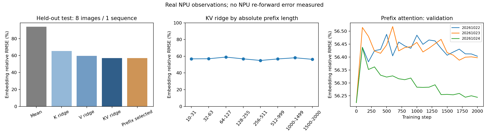
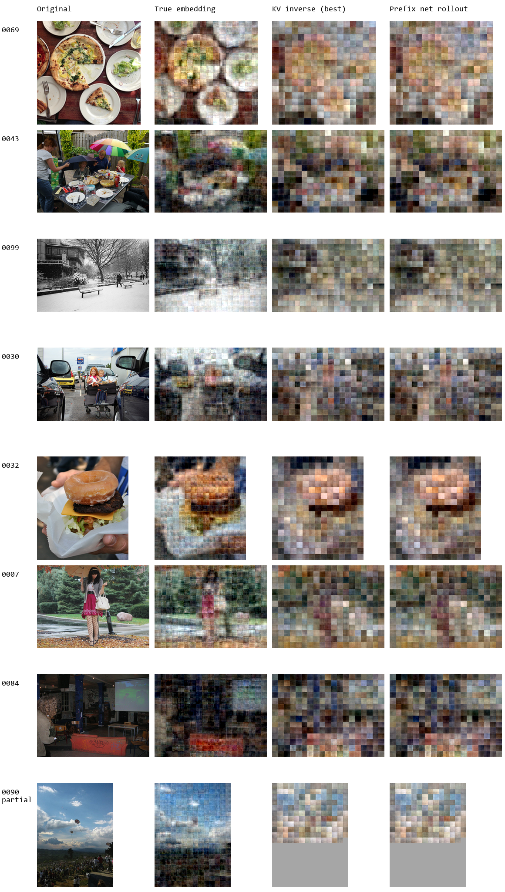

# 真实 NPU K/V 逆向训练与图片重建

日期：2026-10-22。基于数据 Release `v2026.10.22-pilot`，数据来源提交
`8e4005d4dd9fbc314628f0b3c7ca62d2cb59ac91`。原始采集数据未改变。

本次是小规模可行性实验。逆向模型训练完成，但前缀注意力网络没有在验证集上超过线性初始化；
图片重建主要保留粗略色彩和布局，尚不能可靠还原细节。

## 数据与误差单位

- 训练：40 张图片、6 条上下文、11,862 个目标位置。
- 验证：8 张图片、1 条上下文、1,977 个目标位置。
- 测试：8 张图片、1 条上下文、1,977 个目标位置。
- 保持原有图片级划分；检查图片 ID、原图哈希无交叉，序列标签与独立图片 embedding 逐位一致。
- 输入为当前位置真实 NPU 输出的 INT8 K/V，宽度 `512 + 512`，绝对位置，以及严格早于当前位置的 embedding。
- adapter 后标签为 FP32、1536 维。训练时将 INT8 数值转换为 FP32 并使用训练集统计量标准化；没有模拟生成 INT8 观测。
- K 的量化 scale 为 `0.0011563472216948867`，V 为 `0.01785714365541935`，两者 zero point 均为 0。
- embedding RMSE 是每维浮点误差；相对 RMSE 为 `RMSE / 真实 embedding RMS`。不能将它们当作 K/V LSB 或恢复成功率。

## 逆向模型

先比较 K-only、V-only 和 K+V 的岭回归，正则参数由验证集选择。再以最优 K+V 回归初始化，
训练只用当前 K/V 的网络和加入严格前缀交叉注意力的网络。

网络含 2 个 192 维模块、4 个注意力头，前缀版本约 138 万可训练参数；线性初始化作为固定 buffer 保留。
每步从一条训练序列取 64 个独立查询，在 8 个前缀长度档中均匀采样。查询间不能互相注意，
前缀注意力严格屏蔽当前和未来位置。每个模型训练 2000 步，使用 AdamW 和余弦学习率。
三个随机种子为 `20261022`、`20261023`、`20261024`；验证集每 100 步选一次检查点。

下表在同一个测试集上评估，网络数值为三个种子的均值：

| 方法 | embedding RMSE | 相对 RMSE | 平均余弦相似度 |
|---|---:|---:|---:|
| K-only 岭回归 | 0.352159 | 65.34% | 0.770679 |
| V-only 岭回归 | 0.321564 | 59.66% | 0.814919 |
| K+V 岭回归 | **0.306597** | **56.89%** | **0.834342** |
| 第 2000 步前缀网络，真实前缀 | 0.308077 | 57.16% | 0.832706 |
| 第 2000 步前缀网络，预测前缀连续恢复 | 0.308322 | 57.21% | 0.832462 |

**三个种子的验证集最优检查点均为第 0 步，即线性初始化。** `prefix_model.pt` 保存该最优检查点，
`prefix_last.pt` 保存训练到第 2000 步的网络。前者不依赖前缀，因此其真实前缀与连续恢复结果一致，
不能用这种一致性证明抗误差能力。后者单独评估真实前缀和连续恢复，结果见上表。

连续恢复从绝对位置 5 开始，预测所有图片行，包括不在 `target_positions` 中的最初 5 个图片位置；
已知模板及 EOI/BOI embedding 保留。没有使用原图、当前 embedding 或未来 embedding 作为逆向预测输入。

训练到最后时，前缀网络在固定训练子集上的相对 RMSE 约为 43.2%，测试约为 57.2%。
当前结果既存在拟合误差，也存在泛化差距，不能直接断言扩大数据就能解决问题。



## 图片重建

按数据清单下载 56 张 COCO 原始 JPEG，并逐张核对 SHA-256。图片解码器只用 40 张训练图片的
真实 embedding 配对像素训练，在另外 8 张验证图片上选择；测试图片不参与训练或选模型。

比较了保持空间网格的 CNN（3000 步）和线性分块解码器，验证集 MSE 分别约为 0.02524 和 0.01199，
因此展示与主要评估使用线性分块解码器。它把每个 token 解码为 `12 × 12` 像素，按原空间网格拼接。
这属于借鉴空间 token 解码思路的自定义实验，不是任何论文官方代码的复现。

输出为手机预处理尺寸的四分之一，通常约 170–240 像素尺度；展示时使用最近邻放大重建图，
没有生成式补图。参考图采用 PIL Lanczos 缩放，与手机 STB 预处理不逐像素一致。

| 输入 | 像素 MSE ↓ | 平均 PSNR ↑ | 平均 SSIM ↑ |
|---|---:|---:|---:|
| 真实 embedding | 0.013416 | 18.995 dB | 0.4000 |
| 验证集选出的 K/V 逆向模型 | 0.047001 | 13.367 dB | 0.1791 |
| 第 2000 步前缀网络连续恢复，种子 20261022 | 0.047599 | 13.313 dB | 0.1772 |
| 训练集均值 embedding | 0.074186 | 11.447 dB | 0.2353 |
| 打乱空间顺序的真实 embedding | 0.105844 | 10.084 dB | 0.0609 |

以上是 7 张完整测试图逐图指标的平均，不是把所有像素混合后计算。均值基线的 SSIM 高于 K/V 反演，
也提示不能只用单个相似度指标判断物体细节是否恢复。

第 8 张图片 `0090` 只采集了 `153/266` 个图片 token，缺失输入以训练均值填充，显示区域标灰；
不计入完整图片平均指标。其单图指标仅统计已观测位置覆盖的区域。

左起：缩小的原图 / 真实 embedding / 最佳 K/V 逆向模型 / 前缀网络连续恢复。



真实 embedding 能保留部分物体轮廓和布局，预测 embedding 又带来明显额外损失。
但仅用 40 张训练图得到的解码器不能代表真实 embedding 的理论恢复上限。

## 下载实验文件

代码、JSON 指标、审计记录和对照图保存在 Git 中。模型、逐位置预测和推理示例输入放在
[实验 Release](https://github.com/slittlefingers/gemma4-image-prefix-dataset/releases/tag/v2026.10.22-experiments)，
原始数据仍从 [采集 Release](https://github.com/slittlefingers/gemma4-image-prefix-dataset/releases/tag/v2026.10.22-pilot) 下载。

在仓库根目录执行：

```bash
gh release download v2026.10.22-pilot --repo slittlefingers/gemma4-image-prefix-dataset --pattern '*.tar.gz'
tar -xzf gemma4-image-prefix-20261022.tar.gz
gh release download v2026.10.22-experiments --repo slittlefingers/gemma4-image-prefix-dataset --pattern '*.tar.gz' --pattern EXPERIMENT_SHA256SUMS
sha256sum -c EXPERIMENT_SHA256SUMS
tar -xzf gemma4-image-prefix-experiments-20261022.tar.gz
```

实验包解压到 `experiments/20261022_npu_prefix/`；逐文件大小和 SHA-256 见
[artifact_manifest.json](artifact_manifest.json)。包内含三个种子的最优/最后一步网络、岭回归模型、
全部已报告方法的测试预测、图片解码器和完整测试序列的预测 embedding。
不包含原始 JPEG、Gemma 模型权重或手机运行时。

## 复现

测试环境为 Windows、RTX 5070、Python 3.12、PyTorch 2.13.0+cu132；详细版本见
[summary.json](summary.json) 的 `environment`。训练脚本要求可用的 CUDA PyTorch 环境。

```bash
python -m pip install -r experiments/20261022_npu_prefix/requirements.txt

python experiments/20261022_npu_prefix/train.py --seed 20261022 --steps 2000 --out experiments/20261022_npu_prefix/results_seed20261022
python experiments/20261022_npu_prefix/train.py --seed 20261023 --steps 2000 --out experiments/20261022_npu_prefix/results_seed20261023
python experiments/20261022_npu_prefix/train.py --seed 20261024 --steps 2000 --out experiments/20261022_npu_prefix/results_seed20261024
python experiments/20261022_npu_prefix/summarize.py

python experiments/20261022_npu_prefix/reconstruction/download_images.py
python experiments/20261022_npu_prefix/reconstruction/reconstruct.py --steps 3000
```

训练结果目录和已下载检查点同名，复现会更新这些本地文件。一次查询的输入 NPZ 仅包含
`prefix: float32[p,1536]` 和 `kv: int8[1024]`，不含当前或未来 embedding：

```bash
python experiments/20261022_npu_prefix/infer.py --checkpoint experiments/20261022_npu_prefix/results_seed20261022/prefix_last.pt --input experiments/20261022_npu_prefix/inference_input.npz --output embedding.npy
```

## 检查和结论边界

- 更改当前及未来 embedding，所测位置输出完全不变。
- 并行查询与使用真实历史的逐位置计算最大绝对差约 `1.79e-6`。
- GPU 检查点重载输出完全一致；独立单位置推理与保存的批量预测差约 `6.56e-7`。
- 图片解码器保存后重载检查通过；8-bit PNG 比较另含最多 `0.5/255` 的存图舍入误差。
- 观测来自真实 NPU，但没有把预测 embedding 再放回 NPU，因此没有测得预测引起的 K/V LSB 误差。
- 数据采集的固定 prefill 路径与单位置查询仍有已知差异，不能直接混用严格阈值。
- 只有一个验证上下文和一个测试上下文，token 位置相关；三个种子不是三个独立测试集。
- 目前结果不支持完整图片恢复、精确文字恢复、身份确认或原图唯一性取证结论。

## 图片来源与许可

对照图中的图片及其重建示意对应 COCO val2017 的公开来源，逐图 URL、COCO ID、哈希和原始许可见
[figure_sources.json](reconstruction/figure_sources.json)。原图缩放与重建示意用于展示实验结果，
没有将照片或其衍生内容重新统一授权为 Apache-2.0；原始照片的各自许可仍适用。
本目录新增实验代码沿用仓库的 Apache-2.0 代码许可。
