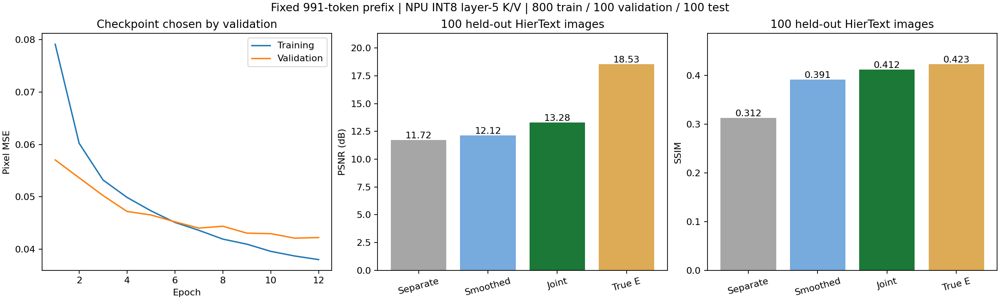
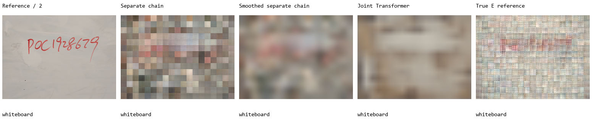

# 固定 991-token 前缀：RASR 思路的小规模图像重建验证

**联合像素重建优于本次测量的线性基线，但尚未恢复白板文字。**
这是 [Inverting the Hidden](https://arxiv.org/html/2608.01020v1) 初始视觉重建阶段的缩小适配，不能视为论文完整复现。

## 数据与方法

- 数据版本：`955a392`，对应 [固定前缀 1000 张数据发布](https://github.com/slittlefingers/gemma4-image-prefix-dataset/releases/tag/v2026.10.23-fixed-prefix-1000)。
- 1000 张 HierText 图片按来源图片 ID 确定性划分为 **800 训练 / 100 验证 / 100 测试**；来源 ID、原图哈希无交叉。全部数组文件通过 SHA256 检查。
- 白板图是额外的独立测试对象，其像素和真实特征不用于训练、归一化或 checkpoint 选择。先保存 K/V-only 重建，再打开白板真值计算指标。
- 输入为真实手机 NPU 第 5 层（索引 4）的 **INT8 K/V**，每个位置 512 维 K + 512 维 V。归一化统计只使用训练集。
- 一次输入整张图的所有图像位置，通常约 260 个，保留原生空间网格。前缀固定为 991 tokens；本实验没有测试不同前缀之间的泛化。
- 网络：单层因果 Transformer（宽度 256）→ 1536 维潜变量 → 两层 MLP → 768 维潜变量 → 视觉 Transformer（宽度 192）→ U-net 风格卷积和渐进上采样。
- **只用图像像素 MSE 联合训练；中间潜变量不接受真实 embedding/视觉特征监督。**
- 模型共 **4,645,622 参数**，一个随机种子 `20261023`，batch size 3，AdamW，学习率 `3e-4`，100 步 warm-up 后线性衰减，12 epochs / 3384 steps。验证集选择第 11 轮。神经网络训练阶段耗时 **88.66 秒**（RTX 5070），不包括下载、加载、线性基线拟合和评估。
- 输出每个图像 token 对应 24×24 像素，是 native STB 图像宽高各一半。标签由 native RGB 做 2×2 area reduction；没有生成式补图或超分辨率。

输入观测是 INT8，不代表恢复网络也以 INT8 训练。网络采用 BF16 混合精度；adapter 后 embedding 标签为 FP32，仅供线性基线使用。训练缓存像素标签为 FP16；补充诊断使用 FP32 像素真值复算，缓存引入的平均像素 MSE 约 `1.08e-8`。

## 同一批 100 张测试图的结果

下表采用 [diagnostics.json](results/diagnostics.json) 中的 FP32 真值复算结果。PSNR、SSIM 都先按图片计算再平均，像素取值范围为 `[0,1]`。

| 方法 | 像素 MSE ↓ | PSNR ↑ | SSIM ↑ |
|---|---:|---:|---:|
| 分别拟合 KV→embedding→像素，两段 ridge | 0.07164335 | 11.71919 dB | 0.31239 |
| 上述链路 + 验证集选择的高斯平滑 | 0.06611864 | 12.12056 dB | 0.39122 |
| 直接 KV→像素 ridge | 0.07167674 | 11.72073 dB | 0.31108 |
| **联合 Transformer 重建** | **0.05092539** | **13.28107 dB** | **0.41197** |
| 真实 embedding→像素 ridge，供参考 | 0.01571822 | 18.52790 dB | 0.42257 |

联合模型相比未平滑的分段线性基线，平均像素 MSE 下降约 **28.9%**；相比平滑后的基线下降约 **23.0%**。后者的配对图片 bootstrap MSE 差为 `−0.01519`，95% 区间为 `[−0.01846, −0.01209]`。这反映测试图片抽样差异，不包含训练随机种子的不确定性。

平滑对照是在初次查看重建图后补充的诊断，sigma 从 `[0,1,2,4,8,12,24]` 中仅用验证集选择，最终为 12 个输出像素；没有更换联合模型 checkpoint。结果说明改善不完全来自消除块状噪声，但本实验没有隔离网络容量与联合损失各自的贡献。



[查看 10 张测试图片还原样例](test_gallery/README.md) · [六张示例概览](results/test_overview.png) · [查看平滑对照](results/test_smoothing_control.png)

样例从按 ID 排序的测试集中固定间隔选取第 1、11、21……91 张，逐图提供原尺寸参考 PNG、联合模型 PNG、五列重建对照和指标。使用同一个冻结模型导出，10 张图的所有已核对指标与原报告完全一致（最大差为 0），未重新训练或选择模型。

真实 embedding 解码结果是一个参考解码器的表现，不是信息恢复上限。新数据来源和输出分辨率不同，不应直接与上一轮 COCO 指标比较。

## 独立白板结果：文字未恢复

左起：参考图 / 分段线性链路 / 平滑后的线性链路 / 联合 Transformer / 真实 embedding 解码参考。



联合重建的白板 PSNR 为 **16.51 dB**，SSIM 为 **0.8772**，但红色手写文字不可读。使用训练集平均 RGB 的纯色图，其白板 SSIM 也能达到 **0.8954**。因此高 SSIM 不能证明文字或 password 已恢复。

白板联合重建与真图的梯度幅值相关性为 `−0.0494`，也不支持文字边缘已恢复。该补充指标是 sigma=1 高斯平滑后 Sobel 梯度幅值的 Pearson 相关性，**不是字符识别率，也不是对论文边缘指标的原样复现**。白板没有独立核对的文字标注，不报告 exact-match 成功率。

## 与论文的差别和限制

论文使用完整 hidden states，本实验使用 NPU INT8 K/V；网络规模、数据量和训练设置也不同。这里只适配了联合像素监督的初始视觉重建路径，没有执行需要匹配原模型可微前端的 consistency-guided refinement。**没有测量重建图片重新跑 NPU 后的 K/V 误差。**

目前只能支持“所测联合模型改善粗略像素重建”，不能支持精确图片恢复、文字恢复、跨前缀泛化或唯一性取证结论。

## 复现

在仓库根目录下载数据，再运行本目录脚本。先安装适配显卡的 CUDA PyTorch，然后安装其他依赖。

```bash
gh release download v2026.10.23-fixed-prefix-1000 \
  --repo slittlefingers/gemma4-image-prefix-dataset \
  --dir downloads/20261023_fixed991 --pattern '*.tar.gz'
python -m pip install -r experiments/20261023_fixed991_rasr/requirements.txt
python experiments/20261023_fixed991_rasr/prepare.py
python experiments/20261023_fixed991_rasr/run.py --epochs 12
python experiments/20261023_fixed991_rasr/diagnostics.py
python experiments/20261023_fixed991_rasr/report.py
```

本次 Git 提交包含报告、指标、图表、审计和脚本，**不包含模型 checkpoint 或数据数组**。上述训练命令会生成 `results/joint_best.pt`、`ridges.pt` 等；之后可用 `run.py --reuse` 重新评估。不同硬件/软件环境不保证训练结果逐位相同。

代码发布时只修改了仓库相对路径和作图字体，不改训练计算；详见 [publication.json](publication.json)。原始运行的脚本/模型哈希保存在 [original_run_artifact_hashes.json](results/original_run_artifact_hashes.json)，发布文件哈希另存于 [publication_hashes.json](publication_hashes.json)。后者按提交中的 Git blob 原始字节计算；Windows checkout 自动转换换行后，文本文件的工作区字节哈希可能不同。

- [完整纯文本报告](report.txt)
- [主实验指标与逐图片结果](results/summary.json)
- [补充诊断、FP32 复算与逐图片结果](results/diagnostics.json)
- [训练轨迹](results/training.json) · [数据划分与校验](results/data_audit.json)
- [测试前冻结的模型哈希](results/frozen_before_test.json) · [下载校验](download_audit.json)

## 图像来源

测试图和其重建衍生图来自 [HierText](https://github.com/google-research-datasets/hiertext)，按 [CC BY-SA 4.0](HIERText_LICENSE.txt) 发布。图片 ID、原图哈希和图表编号见 [figure_sources.json](figure_sources.json)。图片处理包括 native STB 缩放、半分辨率取样、模型重建和平滑对照。

白板照片由用户授权公开，来源与许可说明见 [测试对象说明](../../important_test/whiteboard/README.md)，不自动套用 HierText 许可证。
