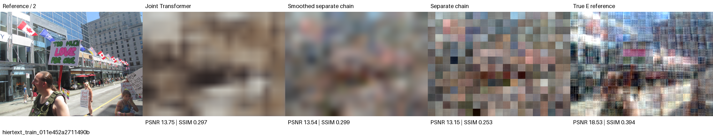
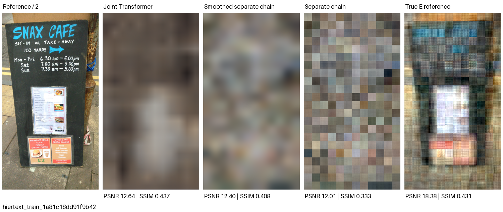
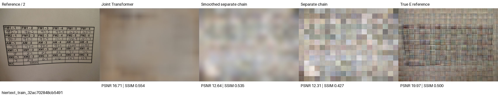
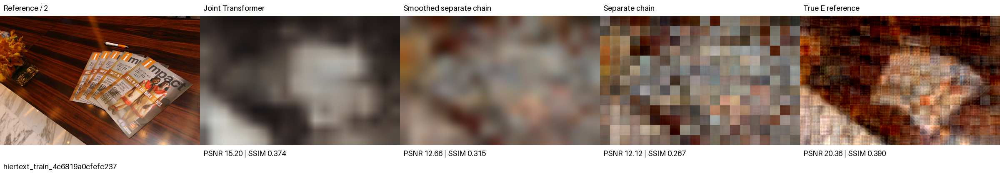
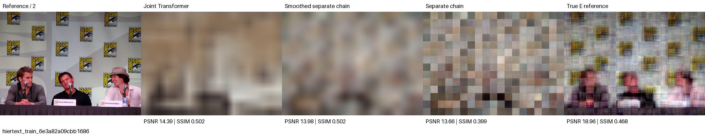
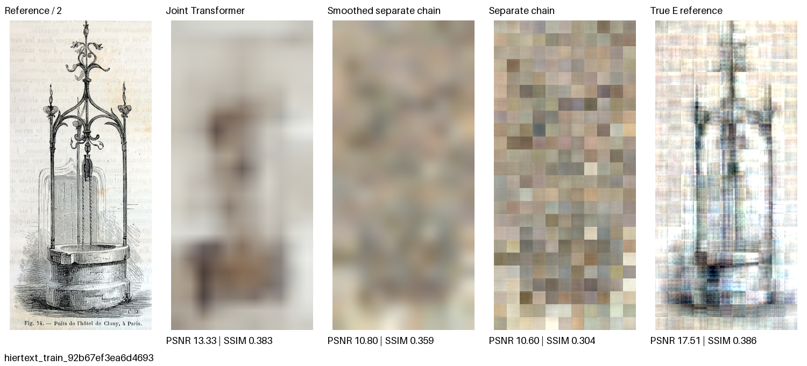
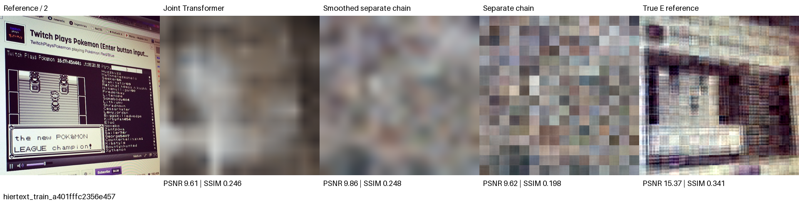
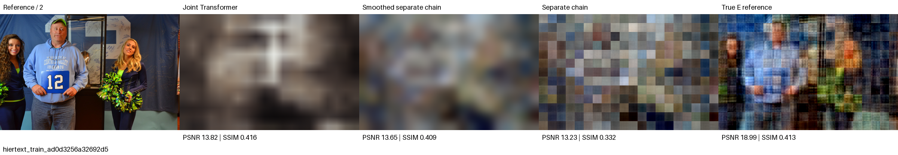
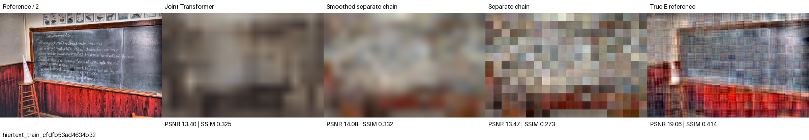
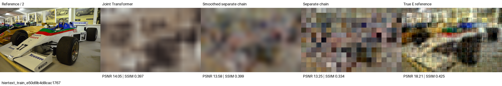

# 测试图片还原：10 张样例

**从 100 张留出测试图中，按 ID 排序后每隔 10 张取一张：第 1、11、21……91 张。** 不根据重建质量挑选。使用原先冻结的第 11 轮模型，不重新训练或选择 checkpoint。

[实验总报告](../README.md) · [这 10 张的指标与来源](gallery_metrics.json) · [导出校验](export_audit.json)

整体上仍主要恢复模糊的明暗和大块布局，细节与文字明显丢失。完整 100 张测试集的平均 PSNR 为 13.28 dB、SSIM 为 0.412；这些是完整测试集指标，不是下方 10 张的平均，也不是图片恢复成功率。

每组左起：**参考图 / 联合 Transformer / 平滑后的分段线性链路 / 分段线性链路 / 真实 embedding 解码参考**。最后一列需要真实 embedding，仅供参考，不属于 K/V-only 恢复。

参考图是 native STB 图像宽高各减半后的像素，重建图与它尺寸相同。可点击单独 PNG 查看输出原尺寸。指标在保存为 8-bit PNG 之前计算。

| 测试编号 | 图片 ID | 联合模型 PSNR | SSIM | 对照 |
|---:|---|---:|---:|---|
| 001 | 011e452a2711490b | 13.754 dB | 0.2974 | [查看](comparisons/001_011e452a2711490b.png) |
| 011 | 1a81c18dd91f9b42 | 12.641 dB | 0.4374 | [查看](comparisons/011_1a81c18dd91f9b42.png) |
| 021 | 32ac702848cb5491 | 16.706 dB | 0.5544 | [查看](comparisons/021_32ac702848cb5491.png) |
| 031 | 4c6819a0cfefc237 | 15.198 dB | 0.3737 | [查看](comparisons/031_4c6819a0cfefc237.png) |
| 041 | 6e3a82a09cbb1686 | 14.391 dB | 0.5019 | [查看](comparisons/041_6e3a82a09cbb1686.png) |
| 051 | 92b67ef3ea6d4693 | 13.331 dB | 0.3833 | [查看](comparisons/051_92b67ef3ea6d4693.png) |
| 061 | a401fffc2356e457 | 9.614 dB | 0.2455 | [查看](comparisons/061_a401fffc2356e457.png) |
| 071 | ad0d3256a32692d5 | 13.823 dB | 0.4157 | [查看](comparisons/071_ad0d3256a32692d5.png) |
| 081 | cfdfb53ad4634b32 | 13.402 dB | 0.3252 | [查看](comparisons/081_cfdfb53ad4634b32.png) |
| 091 | e50d9b4d8cac1767 | 14.054 dB | 0.3972 | [查看](comparisons/091_e50d9b4d8cac1767.png) |

## 样例 1 · 测试编号 001

图片 ID：`011e452a2711490b`；输出 456×336，266 个图像位置。



[参考图 PNG](images/001_011e452a2711490b_reference.png) · [联合模型重建 PNG](images/001_011e452a2711490b_joint.png)

| 方法 | 像素 MSE ↓ | PSNR ↑ | SSIM ↑ |
|---|---:|---:|---:|
| 联合模型 | 0.042131 | 13.754 dB | 0.2974 |
| 平滑分段链路 | 0.044228 | 13.543 dB | 0.2987 |
| 分段链路 | 0.048440 | 13.148 dB | 0.2529 |
| 真实 embedding 参考 | 0.014024 | 18.531 dB | 0.3938 |

## 样例 2 · 测试编号 011

图片 ID：`1a81c18dd91f9b42`；输出 288×528，264 个图像位置。



[参考图 PNG](images/011_1a81c18dd91f9b42_reference.png) · [联合模型重建 PNG](images/011_1a81c18dd91f9b42_joint.png)

| 方法 | 像素 MSE ↓ | PSNR ↑ | SSIM ↑ |
|---|---:|---:|---:|
| 联合模型 | 0.054432 | 12.641 dB | 0.4374 |
| 平滑分段链路 | 0.057559 | 12.399 dB | 0.4084 |
| 分段链路 | 0.062919 | 12.012 dB | 0.3325 |
| 真实 embedding 参考 | 0.014518 | 18.381 dB | 0.4315 |

## 样例 3 · 测试编号 021

图片 ID：`32ac702848cb5491`；输出 456×336，266 个图像位置。



[参考图 PNG](images/021_32ac702848cb5491_reference.png) · [联合模型重建 PNG](images/021_32ac702848cb5491_joint.png)

| 方法 | 像素 MSE ↓ | PSNR ↑ | SSIM ↑ |
|---|---:|---:|---:|
| 联合模型 | 0.021349 | 16.706 dB | 0.5544 |
| 平滑分段链路 | 0.054447 | 12.640 dB | 0.5355 |
| 分段链路 | 0.058811 | 12.305 dB | 0.4270 |
| 真实 embedding 参考 | 0.010065 | 19.972 dB | 0.5004 |

## 样例 4 · 测试编号 031

图片 ID：`4c6819a0cfefc237`；输出 480×312，260 个图像位置。



[参考图 PNG](images/031_4c6819a0cfefc237_reference.png) · [联合模型重建 PNG](images/031_4c6819a0cfefc237_joint.png)

| 方法 | 像素 MSE ↓ | PSNR ↑ | SSIM ↑ |
|---|---:|---:|---:|
| 联合模型 | 0.030213 | 15.198 dB | 0.3737 |
| 平滑分段链路 | 0.054231 | 12.657 dB | 0.3154 |
| 分段链路 | 0.061405 | 12.118 dB | 0.2671 |
| 真实 embedding 参考 | 0.009214 | 20.355 dB | 0.3900 |

## 样例 5 · 测试编号 041

图片 ID：`6e3a82a09cbb1686`；输出 456×336，266 个图像位置。



[参考图 PNG](images/041_6e3a82a09cbb1686_reference.png) · [联合模型重建 PNG](images/041_6e3a82a09cbb1686_joint.png)

| 方法 | 像素 MSE ↓ | PSNR ↑ | SSIM ↑ |
|---|---:|---:|---:|
| 联合模型 | 0.036385 | 14.391 dB | 0.5019 |
| 平滑分段链路 | 0.040007 | 13.979 dB | 0.5022 |
| 分段链路 | 0.043044 | 13.661 dB | 0.3987 |
| 真实 embedding 参考 | 0.012717 | 18.956 dB | 0.4679 |

## 样例 6 · 测试编号 051

图片 ID：`92b67ef3ea6d4693`；输出 264×576，264 个图像位置。



[参考图 PNG](images/051_92b67ef3ea6d4693_reference.png) · [联合模型重建 PNG](images/051_92b67ef3ea6d4693_joint.png)

| 方法 | 像素 MSE ↓ | PSNR ↑ | SSIM ↑ |
|---|---:|---:|---:|
| 联合模型 | 0.046442 | 13.331 dB | 0.3833 |
| 平滑分段链路 | 0.083125 | 10.803 dB | 0.3587 |
| 分段链路 | 0.087101 | 10.600 dB | 0.3039 |
| 真实 embedding 参考 | 0.017756 | 17.507 dB | 0.3864 |

## 样例 7 · 测试编号 061

图片 ID：`a401fffc2356e457`；输出 384×384，256 个图像位置。



[参考图 PNG](images/061_a401fffc2356e457_reference.png) · [联合模型重建 PNG](images/061_a401fffc2356e457_joint.png)

| 方法 | 像素 MSE ↓ | PSNR ↑ | SSIM ↑ |
|---|---:|---:|---:|
| 联合模型 | 0.109307 | 9.614 dB | 0.2455 |
| 平滑分段链路 | 0.103363 | 9.856 dB | 0.2482 |
| 分段链路 | 0.109168 | 9.619 dB | 0.1983 |
| 真实 embedding 参考 | 0.029067 | 15.366 dB | 0.3414 |

## 样例 8 · 测试编号 071

图片 ID：`ad0d3256a32692d5`；输出 480×312，260 个图像位置。



[参考图 PNG](images/071_ad0d3256a32692d5_reference.png) · [联合模型重建 PNG](images/071_ad0d3256a32692d5_joint.png)

| 方法 | 像素 MSE ↓ | PSNR ↑ | SSIM ↑ |
|---|---:|---:|---:|
| 联合模型 | 0.041471 | 13.823 dB | 0.4157 |
| 平滑分段链路 | 0.043105 | 13.655 dB | 0.4094 |
| 分段链路 | 0.047541 | 13.229 dB | 0.3321 |
| 真实 embedding 参考 | 0.012613 | 18.992 dB | 0.4127 |

## 样例 9 · 测试编号 081

图片 ID：`cfdfb53ad4634b32`；输出 480×312，260 个图像位置。



[参考图 PNG](images/081_cfdfb53ad4634b32_reference.png) · [联合模型重建 PNG](images/081_cfdfb53ad4634b32_joint.png)

| 方法 | 像素 MSE ↓ | PSNR ↑ | SSIM ↑ |
|---|---:|---:|---:|
| 联合模型 | 0.045689 | 13.402 dB | 0.3252 |
| 平滑分段链路 | 0.039127 | 14.075 dB | 0.3322 |
| 分段链路 | 0.044942 | 13.473 dB | 0.2730 |
| 真实 embedding 参考 | 0.012413 | 19.061 dB | 0.4135 |

## 样例 10 · 测试编号 091

图片 ID：`e50d9b4d8cac1767`；输出 480×312，260 个图像位置。



[参考图 PNG](images/091_e50d9b4d8cac1767_reference.png) · [联合模型重建 PNG](images/091_e50d9b4d8cac1767_joint.png)

| 方法 | 像素 MSE ↓ | PSNR ↑ | SSIM ↑ |
|---|---:|---:|---:|
| 联合模型 | 0.039318 | 14.054 dB | 0.3972 |
| 平滑分段链路 | 0.043834 | 13.582 dB | 0.3992 |
| 分段链路 | 0.047277 | 13.254 dB | 0.3344 |
| 真实 embedding 参考 | 0.015108 | 18.208 dB | 0.4250 |

## 来源与复现

来源为 HierText 官方 train split，在本实验的 1000 张图片中按图片 ID 留出 100 张作为测试集；本报告从中固定间隔取 10 张。白板是额外的独立测试对象，不在这 10 张中。

原图 ID、原图和采集数组哈希、导出 PNG 哈希保存在 `gallery_metrics.json`。10 张图片的指标与此前发布的同图指标完全一致，最大差为 0。

图片与重建衍生图来自 [HierText](https://github.com/google-research-datasets/hiertext)，按 [CC BY-SA 4.0](../HIERText_LICENSE.txt) 发布。变换包括 native STB 缩放、半分辨率取样、模型重建和平滑处理。

已有匹配的冻结 checkpoint 后，在仓库根目录运行：

```bash
python experiments/20261023_fixed991_rasr/export_test_gallery.py --checkpoints /path/to/original/results
```

脚本验证 checkpoint 哈希，然后导出同样的 10 张。模型 checkpoint 不包含在本次 Git 提交中。
